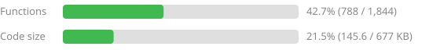

# Shadow Tower Abyss decompilation

Work-in-progress decompilation of Shadow Tower Abyss (PS2, `SLPS_252.17`, Japan).
Built with Metrowerks MW MIPS C 2.4.1.01.

This repository contains no game data. You need your own copy of the game.

## Setup

1. Copy `SLPS_252.17` from your disc into the repo root.
   SHA-1: `283c43ed15120b1578869c536a1fa1ca05ca9732`
2. Linux/WSL: `sudo apt install binutils-mips-linux-gnu ninja-build python3-venv`,
   plus [wibo](https://github.com/decompals/wibo) on `PATH`.
3. `python3 -m venv .venv && .venv/bin/pip install -r requirements.txt`
4. Put the decomp.me compiler `mwcps2-3.0b52-030722` in `tools/mwcc/3.0b52-030722/`.
   The game is built with `-O4,p`: optimizing for speed pads branch targets to 8 bytes with a `nop`,
   which only the 3.0b38–3.0b52 builds do. A few files use plain `-O4` (`NO_SPEED` in `configure.py`).
5. `.venv/bin/python configure.py --split && ninja`

`ninja` builds `build/main.bin` (the loaded segment) and checks its SHA-1 against `config/main.sha1`.

## Decompiling a function

Matched functions live in `src/`, each file listed as a `c` subsegment in the yaml between
`asm` subsegments. Check a candidate with `tools/diff_func.sh src/file.c START END`
(hex addresses), which diffs the compiled code against the original.

For many small functions at once, `tools/batch.py` checks `// ---`-separated C candidates against the
original and `apply` moves the matches into `src/` (a switch jump table is carved out of the data blob as that file's `.rodata` subsegment). `tools/gen.py` generates candidates for branch-free
functions, and `tools/m2cgen.py` runs [m2c](https://github.com/matt-kempster/m2c) for the rest
(its output uses `include/m2c.h`). Shared structs live in `include/` (e.g. `actor.h`, the object behind the
accessors at 0x13D1C0); list a header in `HEADERS` in `m2cgen.py` so m2c uses its types. For near-misses, `tools/perm_setup.py` prepares a
[decomp-permuter](https://github.com/simonlindholm/decomp-permuter) directory; run the permuter with a
`cpp` symlink to `tools/cpp_shim.sh` first on `PATH` (it stands in for the C preprocessor using MWCC's).
See the docstrings. `docs/MATCHING.md` collects code-shape tricks that got functions to match, and `wip/` holds near-misses
with notes on what still differs. `tools/order_search.py` brute-forces declaration/statement order.

## Progress

Game code: **884 of 1,844 functions matched (48%)**, but they are mostly the small ones, so that is 196.4 KB of 677 KB (**29.0% by size**). Sony SDK and middleware libraries are not counted.
